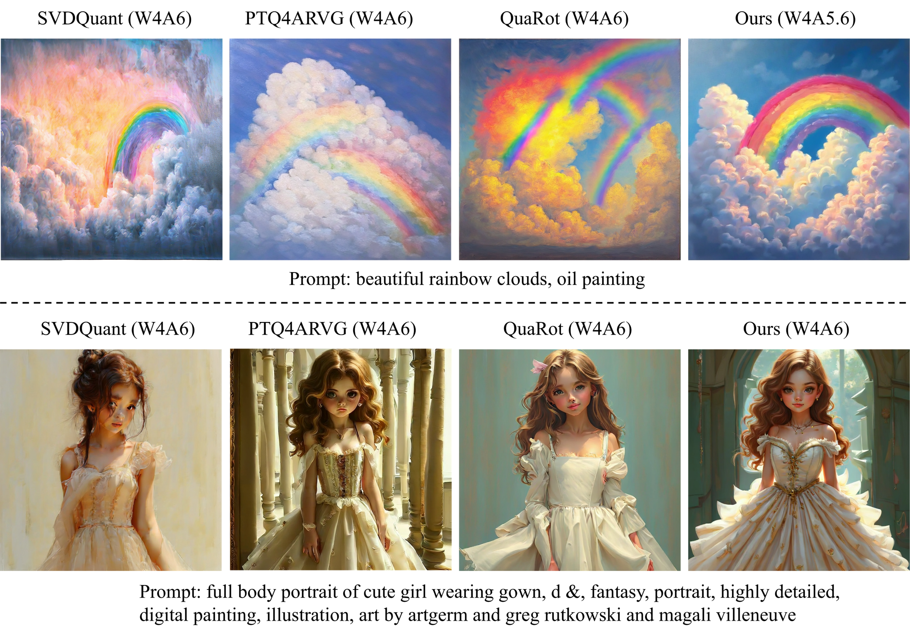
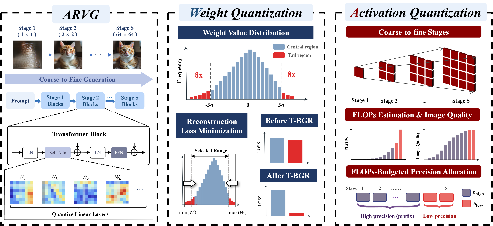
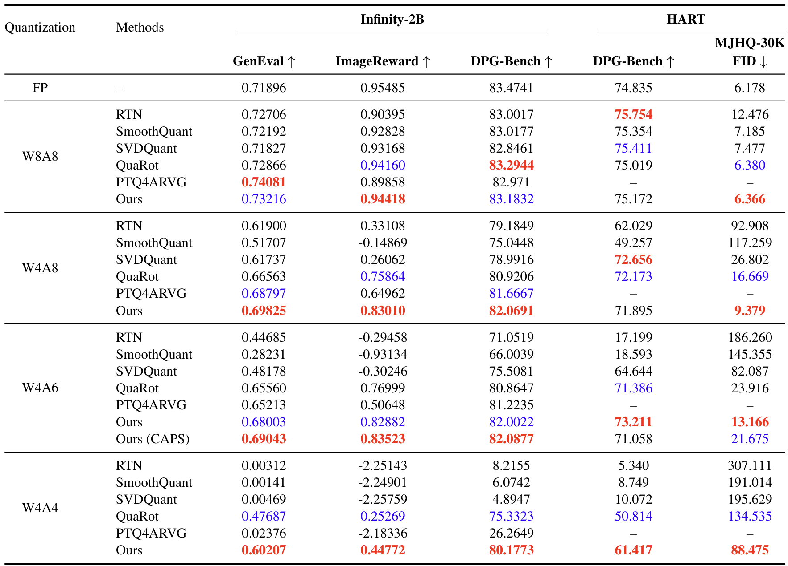
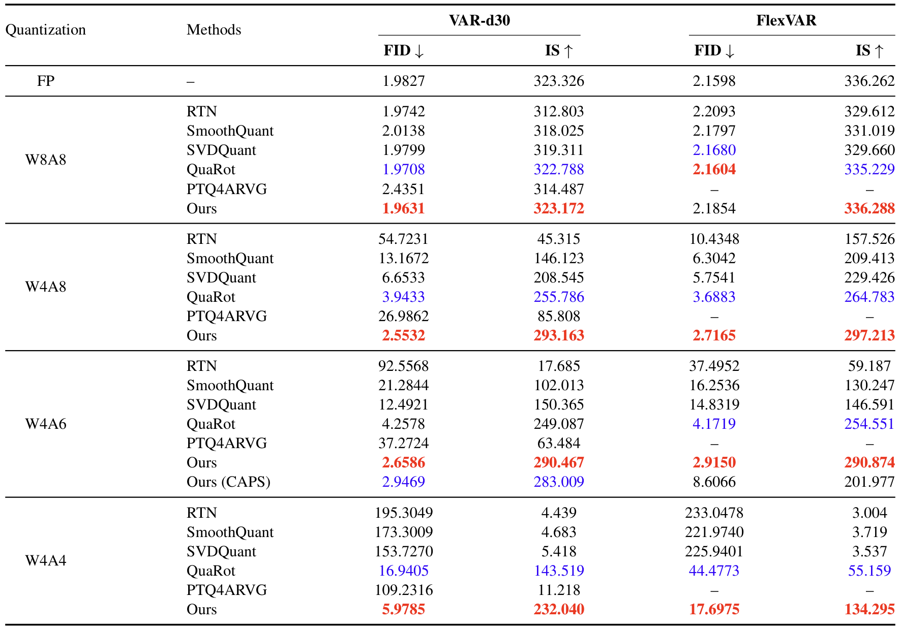

# HGA-Quant: Heterogeneity-Aware Quantization for AutoRegressive Visual Generation Models

<p align="center">
  
</p>

## Abstract

Recently, **AutoRegressive Visual Generation (ARVG) models** have emerged as a competitive paradigm for **high-quality image synthesis**. However, their substantial computational and memory demands make them difficult to deploy on resource-constrained edge devices. **Post-Training Quantization (PTQ)** provides a promising solution to reduce the computational and memory costs of ARVG models, yet existing methods often suffer from substantial image quality degradation under low-bit quantization. In this paper, we propose a training-free PTQ framework for ARVG, consisting of Tail-Aware Bounded-init Grid Refinement (T-BGR) and Coarse-to-Fine Activation Precision Scheduling (CAPS). **T-BGR** introduces **a tail-aware reconstruction objective for weight quantizer calibration**, assigning greater importance to distribution-tail coefficients and preserving fine-grained information without introducing additional parameters or high-precision branches. **CAPS** performs **coarse-to-fine activation precision scheduling** by jointly considering the importance and computational cost of different generation stages, enabling efficient mixed-precision allocation under a given bit budget. Extensive experiments on multiple ARVG backbones demonstrate that our framework consistently improves robustness under aggressive low-bit quantization. Notably, on Infinity, our framework achieves near full-precision image generation quality at an effective W4A5.6 activation precision, while existing methods at W4A6 still exhibit noticeable quality degradation or inconsistent performance.

## Methods

<p align="center">
  
</p>

## Main Results

<details>
<summary>Results for Infinity-2B and HART</summary>
<p align="center">
  
</p>
</details>

<details>
<summary>Results for VAR-d30 and FlexVAR-d24</summary>
<p align="center">
  
</p>
</details>

## Installation

This top-level directory is a workspace rather than a single Python package. Keep the four model repositories in their own environments and follow the corresponding subrepository README for model-specific dependencies, checkpoints, and evaluators.

The shared Random Hadamard implementation is an external dependency. Keep it once at the workspace root:

```bash
cd /path/to/HGA-Quant
git clone https://github.com/Dao-AILab/fast-hadamard-transform
```

Expected layout:

```text
HGA-Quant/
├── assets/
├── fast-hadamard-transform/
├── FlexVAR/
├── HART/
├── Infinity/
└── VAR/
```

The detailed README for each repository is [Infinity](Infinity/README.md), [HART](HART/README.md), [VAR](VAR/README.md) and [FlexVAR](FlexVAR/README.md).

The quantization wrappers expose a common configuration family:

```text
QUANTIZE_WEIGHT=1
QUANTIZE_ACT=1
WEIGHT_BITS=4
ACT_BITS=6
MIXED_ACT_MODE=coarse_to_fine
CTF_ACT_POLICY=early_high
CTF_LOW_BITS=4
CTF_HIGH_BITS=8
CTF_TARGET_AVG_BITS=6.0
USE_HADAMARD=1
USE_TBGR=1
TBGR_OUTLIER_FACTOR=8
TBGR_OUTLIER_SIGMA=3
```

`ACT_BITS` controls uniform activation quantization. In `coarse_to_fine` mode, the stage schedule is controlled  by the `CTF_*` variables instead.

The common execution pattern is:

1. Choose one of the four model repositories.
2. Prepare its checkpoint, dataset, evaluator assets, and model-specific environment.
3. Configure the wrapper. The default HGA configuration is weight quantization with `WEIGHT_BITS=4`, coarse-to-fine activation scheduling with low/high activation bits `4/8`, T-BGR enabled with `TBGR_OUTLIER_FACTOR=8` and `TBGR_OUTLIER_SIGMA=3`, and Hadamard transformation enabled.
4. Run the wrapper and inspect the generated samples and evaluator output under that repository's `output/` directory.

Uniform activation precision can be selected with:

```bash
MIXED_ACT_MODE=default \
ACT_BITS=6 \
bash <model-repository-wrapper>
```

The HGA coarse-to-fine configuration uses:

```bash
MIXED_ACT_MODE=coarse_to_fine \
CTF_ACT_POLICY=early_high \
CTF_LOW_BITS=4 \
CTF_HIGH_BITS=8 \
CTF_TARGET_AVG_BITS=6.0 \
bash <model-repository-wrapper>
```

## Source Projects

The workspace covers the following projects:

| Project | GitHub |
|---|---|
| Infinity | [FoundationVision/Infinity](https://github.com/FoundationVision/Infinity) |
| HART | [mit-han-lab/hart](https://github.com/mit-han-lab/hart) |
| FlexVAR | [jiaosiyu1999/FlexVAR](https://github.com/jiaosiyu1999/FlexVAR) |
| VAR | [FoundationVision/VAR](https://github.com/FoundationVision/VAR) |
| Fast Hadamard Transform | [Dao-AILab/fast-hadamard-transform](https://github.com/Dao-AILab/fast-hadamard-transform) |

## Citation

```bibtex
@article{hgaquant,
  title={HGA-Quant: Heterogeneity-Aware Quantization for AutoRegressive Visual Generation Models},
  author={Liu, Xinmeng and Yan, Xianglong and Yang, Kaicheng and Dong, Weisheng and Zhang, Yulun},
  journal={arXiv preprint},
  year={2026}
}
```
